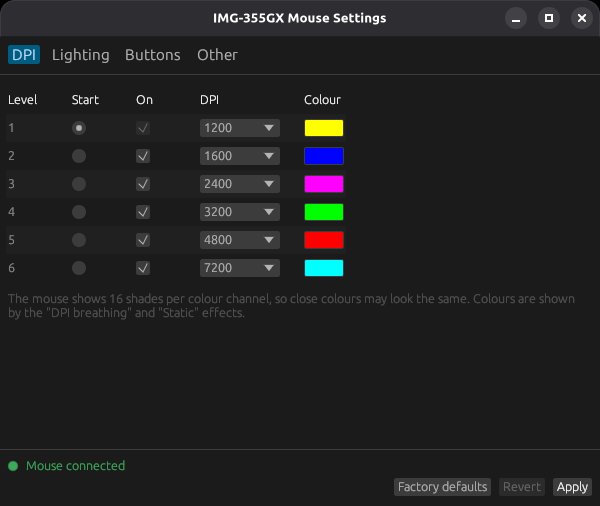

# img355ctl

[Türkçe](README.md) | **English**

Configure the **Inca IMG-355GX** gaming mouse on Linux, without the vendor's
Windows software. Comes as a command line tool (`img355ctl`) and a graphical
app (`img355ctl-gui`).



- 6 DPI levels (200-7200), each with its own LED colour, enable/disable and start level
- 14 LED effects (DPI breathing, cycle breathing, static, flowing water, comet, neon,
  ambilight, Star Trek, ripple, button response, off, ...), speed and cycle colours
- Remap buttons 2-6: middle/right click, forward/back, DPI+/-, DPI loop, double click,
  rapid fire, show desktop, next LED effect, profile selection
- Media keys (volume, play/pause, next/previous, calculator, ...), sent by the mouse
  itself: no background program needed
- Rapid-fire interval
- GUI in English and Turkish, on Wayland and X11

## Where to buy

The IMG-355GX is available on Hepsiburada (Turkey):
**[IMG-355GX gaming mouse on Hepsiburada](https://www.hepsiburada.com/product-p-HBCV0000OG3NG2?magaza=ARI%20B%C4%B0L%C4%B0%C5%9E%C4%B0M%20%C4%B0LET%C4%B0%C5%9E%C4%B0M%20VE%20DANI%C5%9EMANLIK)**

## Supported hardware

| Device | USB ID | Status |
|---|---|---|
| Inca IMG-355GX | `30fa:1040` | tested |
| (other versions using the same software) | `30fa:1140`, `30fa:1440` | untested |

`lsusb` shows the mouse as `INSTANT USB GAMING MOUSE`.

There is a separate tool for the Inca IMG-339:
[Inca-IMG339-Linux](https://github.com/EmreYavuzalp/Inca-IMG339-Linux).

## Install

### Ubuntu, Linux Mint, Debian (easiest)

Download `img355ctl_..._amd64.deb` from the latest
[release](https://github.com/EmreYavuzalp/Inca-IMG355GX-Linux/releases) and
**double-click** it, or:

```sh
sudo apt install ./img355ctl_*_amd64.deb
```

Re-plug the mouse afterwards; the menu shows **IMG-355GX Mouse Settings**. Mouse
access is set up by the package. To uninstall: `sudo apt remove img355ctl`

### Other distributions

Download `img355ctl-...-x86_64-linux.tar.gz` from the release, then:

```sh
tar xzf img355ctl-*-x86_64-linux.tar.gz
cd img355ctl-*-x86_64-linux
./install.sh
```

`install.sh` installs both programs to `~/.local/bin`, adds the menu entry and
installs the udev rule (asks for your sudo password). Re-plug the mouse afterwards.

**Tested on Debian 13.** The prebuilt binaries are built to also run on Debian 11,
Ubuntu 20.04, Linux Mint 20 and newer (64-bit Intel/AMD).

### From source

Requires Rust 1.81 or newer.

```sh
git clone https://github.com/EmreYavuzalp/Inca-IMG355GX-Linux
cd Inca-IMG355GX-Linux
cargo install --path . --root ~/.local --features gui   # CLI and GUI
sudo install -m 644 contrib/70-img355-mouse.rules /etc/udev/rules.d/
sudo udevadm control --reload-rules
install -Dm 644 contrib/img355ctl-gui.desktop ~/.local/share/applications/img355ctl-gui.desktop
```

## Graphical app

`img355ctl-gui` edits the same profile as the CLI. Change DPI levels, colours,
the LED effect and buttons, then press **Apply**. **Revert** goes back to the last
applied settings, **Factory defaults** loads the vendor defaults (press Apply to
send them). Picking the **Static** effect shows one colour picker that sets all six
levels.

## Command line

Every command that changes a setting saves it to
`~/.config/img355ctl/profile.ini` and writes the whole configuration to the mouse,
which keeps it when unplugged.

| Command | |
|---|---|
| `img355ctl status` | detected mouse and current settings |
| `img355ctl dpi LEVEL VALUE` | 200-2400 in steps of 200, or 3200-7200 in steps of 800 |
| `img355ctl dpi LEVEL --off` / `--on` / `--active` | skip a level, re-enable it, start in it |
| `img355ctl color LEVEL COLOR` | `ff8000`, `#f80`, or a name; `all` for every level |
| `img355ctl led EFFECT [--speed 1-6] [--colors "1 3 5"]` | LED effect |
| `img355ctl button N ACTION` | bind button 2-6 |
| `img355ctl fire MS` | rapid-fire interval |
| `img355ctl actions` | functions, media keys and effects |
| `img355ctl reset` | factory defaults |
| `img355ctl -n ...` | dry run: print the USB reports instead of sending them |

Buttons are numbered as in the vendor software: 1 left, 2 right, 3 middle (wheel),
4 forward, 5 back, 6 the button on top (DPI loop by default). Button 1 always stays
the left click, as the vendor software requires.

## Not supported yet

- Macros and shortcuts
- The other three profiles (Game I-III) and per-profile buttons
- Polling rate, brightness

## Troubleshooting

- **Black window:** on very old GPUs the app detects this and restarts itself with
  software OpenGL. If it stays black, try `LIBGL_ALWAYS_SOFTWARE=1 img355ctl-gui`.
- **Verbose log:** `IMG355_LOG=debug img355ctl-gui`.
- **"no permission to open /dev/hidraw…":** the udev rule is missing or was installed
  while the mouse was plugged in; re-plug the mouse.

## Tested on hardware

With a `30fa:1040` mouse on Debian 13 (GNOME, Wayland and X11): factory reset,
static red, the Star Trek effect, 400 DPI and the DPI button, button remapping and
volume up on button 5.

## Development

```sh
cargo test
cargo run --bin img355ctl -- -n reset
cargo run --features gui --bin img355ctl-gui
```

## License

[BSD-3-Clause](LICENSE). Not affiliated with Inca. The vendor software is not included.
