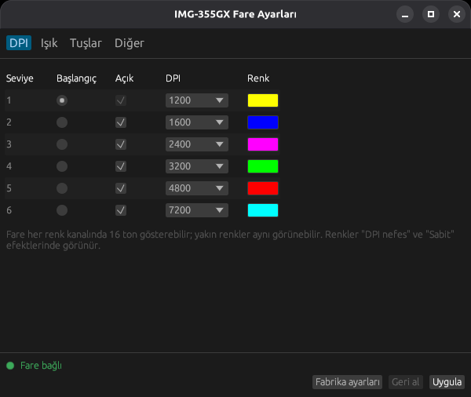
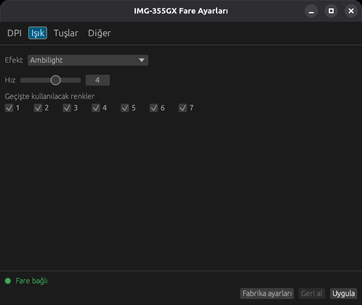
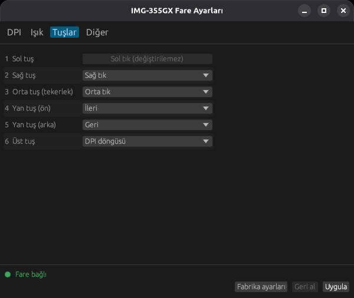

# img355ctl

**Türkçe** | [English](README.en.md)

**Inca IMG-355GX** oyuncu faresini Linux'ta, üreticinin Windows programına gerek
kalmadan ayarlayın. Hem komut satırı aracı (`img355ctl`) hem de Türkçe arayüzlü
bir pencere uygulaması (`img355ctl-gui`) olarak gelir.

<p>
  
  
  
</p>

## Neler yapabilir?

- 6 DPI seviyesi (200-7200): her birine ayrı LED rengi, açma/kapama, başlangıç seviyesi
- 14 LED efekti: DPI nefes, nefes döngüsü, sabit, akan su, kuyruklu yıldız, neon,
  ambilight, Star Trek, dalga, tuş tepkisi, kapalı ve diğerleri; hız ve geçiş renkleri
- Sol tuş dışındaki 5 tuşa işlev atama: orta/sağ tık, ileri/geri, DPI+/-, DPI döngüsü,
  çift tık, seri tık (fire), masaüstünü göster, LED efekti değiştir, profil seçimi
- Medya tuşları (ses, oynat/duraklat, sonraki/önceki, hesap makinesi...). Bunları fare
  kendisi gönderir, arka planda çalışan bir programa gerek yoktur.
- Seri tık (fire) aralığı
- Wayland ve X11'de çalışır. Arayüz sistem diliniz Türkçeyse Türkçe açılır.

## Satın al

IMG-355GX'i Hepsiburada'dan alabilirsiniz:
**[IMG-355GX Gaming Mouse, Hepsiburada](https://www.hepsiburada.com/product-p-HBCV0000OG3NG2?magaza=ARI%20B%C4%B0L%C4%B0%C5%9E%C4%B0M%20%C4%B0LET%C4%B0%C5%9E%C4%B0M%20VE%20DANI%C5%9EMANLIK)**

## Desteklenen fareler

| Fare | USB kimliği | Durum |
|---|---|---|
| Inca IMG-355GX | `30fa:1040` | test edildi |
| (aynı yazılımı kullanan diğer sürümler) | `30fa:1140`, `30fa:1440` | test edilmedi |

Farenizin kimliğini görmek için terminalde `lsusb` yazın. IMG-355GX
`INSTANT USB GAMING MOUSE` olarak görünür.

Inca IMG-339 için ayrı bir araç var:
[Inca-IMG339-Linux](https://github.com/EmreYavuzalp/Inca-IMG339-Linux).

## Kurulum

### Ubuntu, Linux Mint, Debian (en kolayı)

[Releases](https://github.com/EmreYavuzalp/Inca-IMG355GX-Linux/releases) sayfasından
son sürümün `img355ctl_..._amd64.deb` dosyasını indirin, **çift tıklayın** ve
**Yükle**'ye basın. Terminali tercih ederseniz:

```sh
sudo apt install ./img355ctl_*_amd64.deb
```

Kurulumdan sonra fareyi çıkarıp tekrar takın. Menüde **IMG-355GX Fare Ayarları**
görünür. Fare izni kurulum sırasında otomatik ayarlanır. Kaldırmak için:
`sudo apt remove img355ctl`

### Diğer dağıtımlar

Releases sayfasından `img355ctl-...-x86_64-linux.tar.gz` dosyasını indirin, sonra:

```sh
tar xzf img355ctl-*-x86_64-linux.tar.gz
cd img355ctl-*-x86_64-linux
./install.sh
```

`install.sh` programları `~/.local/bin` altına kurar, uygulama menüsüne ekler ve
fareye erişim için udev kuralını kurar (bunun için sudo şifresi sorar). Ardından
fareyi çıkarıp tekrar takın.

**Debian 13'te test edildi.** Hazır dosyalar Debian 11, Ubuntu 20.04, Linux Mint 20
ve sonraki sürümlerde de çalışacak şekilde derlenir (64 bit Intel/AMD).

### Kaynaktan derleyerek

Rust 1.81 ya da daha yenisi gerekir. Debian/Ubuntu'da: `sudo apt install cargo`

```sh
git clone https://github.com/EmreYavuzalp/Inca-IMG355GX-Linux
cd Inca-IMG355GX-Linux
cargo install --path . --root ~/.local --features gui   # komut satırı + arayüz
sudo install -m 644 contrib/70-img355-mouse.rules /etc/udev/rules.d/
sudo udevadm control --reload-rules
install -Dm 644 contrib/img355ctl-gui.desktop ~/.local/share/applications/img355ctl-gui.desktop
```

## Arayüz

`img355ctl-gui` ile DPI seviyelerini, renkleri, LED efektini ve tuşları ayarlayıp
**Uygula**'ya basın, ayarlar fareye gönderilir.

- **Geri al:** son uygulanan ayarlara döner.
- **Fabrika ayarları:** üreticinin varsayılanlarını yükler. Fareye göndermek için yine Uygula'ya basın.
- **Sabit** efekti seçildiğinde tek bir renk seçici çıkar ve renk 6 seviyenin hepsine uygulanır.

Arayüz ve komut satırı aynı ayar dosyasını kullanır.

## Komut satırı

Ayar değiştiren her komut, ayarı `~/.config/img355ctl/profile.ini` dosyasına
kaydeder ve tüm ayarları fareye gönderir. Fare ayarları kendi hafızasında tutar,
çıkarıp takınca kaybolmaz.

| Komut | Ne yapar |
|---|---|
| `img355ctl status` | fare bağlı mı, şu anki ayarlar |
| `img355ctl dpi SEVİYE DEĞER` | bir seviyeyi (1-6) 200-2400 (200'lük adımlar) ya da 3200-7200 (800'lük) yapar |
| `img355ctl dpi SEVİYE --off` / `--on` / `--active` | seviyeyi atlar, geri açar, başlangıç seviyesi yapar |
| `img355ctl color SEVİYE RENK` | `ff8000`, `#f80` ya da renk adı; `all` tüm seviyeler |
| `img355ctl led EFEKT [--speed 1-6] [--colors "1 3 5"]` | LED efekti |
| `img355ctl button NO İŞLEV` | 2-6 numaralı tuşa işlev atar |
| `img355ctl fire MS` | seri tık (fire) aralığı |
| `img355ctl actions` | işlevlerin, medya tuşlarının ve efektlerin listesi |
| `img355ctl reset` | fabrika ayarları |
| `img355ctl -n ...` | deneme: fareye göndermeden komutları ekrana yazar |

Örnekler:

```sh
img355ctl dpi 1 800             # 1. seviye 800 DPI
img355ctl color all red         # tüm seviyeler kırmızı
img355ctl led static            # sabit renk
img355ctl led comet --speed 2   # daha yavaş kuyruklu yıldız
img355ctl led off               # ışıkları kapat
img355ctl button 5 volume-up    # yan tuş sesi açsın
img355ctl reset                 # fabrika ayarlarına dön
```

Tuşlar üreticinin programındaki gibi numaralanır: 1 sol, 2 sağ, 3 orta (tekerlek),
4 ileri, 5 geri, 6 üstteki tuş (varsayılan DPI döngüsü). 1. tuş her zaman sol
tıktır; üreticinin programı da en az bir sol tık ister.

## Henüz desteklenmeyenler

- Makrolar ve kısayollar (kopyala, yapıştır vb.)
- Diğer üç profil (Oyun I-III) ve profil başına tuş atamaları
- Polling rate, parlaklık

## Sorun giderme

- **Pencere siyah kalıyor:** Çok eski ekran kartlarında program bunu kendisi fark edip
  yazılımsal OpenGL ile yeniden açılır. Yine de siyah kalırsa
  `LIBGL_ALWAYS_SOFTWARE=1 img355ctl-gui` ile açmayı deneyin.
- **Ayrıntılı kayıt:** `IMG355_LOG=debug img355ctl-gui` mesajları terminale yazar.
- **"no permission to open /dev/hidraw…":** udev kuralı kurulu değil ya da fare takılıyken
  kuruldu. Fareyi çıkarıp tekrar takın.

## Farede denenenler

Debian 13 (GNOME, Wayland ve X11) üzerinde `30fa:1040` kimlikli bir fareyle:

- fabrika ayarları, sabit kırmızı renk, Star Trek efekti
- 400 DPI, DPI düğmesiyle seviye değiştirme
- tuş atamaları (ileri/geri/DPI döngüsü korunuyor) ve 5. tuşta ses açma

## Lisans

[BSD-3-Clause](LICENSE). Inca ile bir bağlantısı yoktur. Üreticinin yazılımı bu depoya
dahil değildir.
